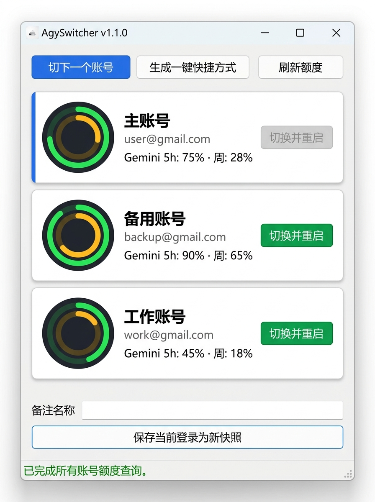

# AgySwitcher

轻量级 Windows 本地 Antigravity 2.0 账号切换工具（单文件约 90 KB，零第三方依赖）。



---

## 特性

- **零外部依赖**：基于 Windows 原生 WinForms + .NET Framework 4.x，无需安装任何运行库。
- **DPAPI 本地加密**：直接读取 Windows 凭据管理器（`gemini:antigravity`），使用 `DataProtectionScope.CurrentUser` 加密保存快照至 `%USERPROFILE%\.agy-profiles\`。
- **额度圆环可视化**（v1.1.0 新增）：每个账号卡片左侧显示双环进度，实时反映当前账号的 Gemini 配额状态：
  - **外环**：Gemini 5h 短期额度
  - **内环**：Gemini 周额度
  - 颜色语义：🟢 正常 / 🟡 ≤ 30% / 🔴 ≤ 0.5%（耗尽）
  - 点击顶部「**刷新额度**」并发查询所有账号
- **三层启动策略**：
  1. 优先抓取运行中主进程启动参数；
  2. 回退读取桌面 / 开始菜单 / 任务栏 `.lnk` 快捷方式；
  3. 回退默认 `Antigravity.exe` + 自定义附加参数。
- **无界面一键直切**：支持 `--next`（静默轮转到下一个账号并重启客户端）与 `--switch <编号>`，可一键生成桌面与开始菜单快捷方式。
- **高分屏自适应**：支持不同 Windows DPI 缩放比例，支持账号备注与 Gmail 自动识别。

---

## 界面说明

| 区域 | 说明 |
|---|---|
| **顶部工具栏** | 「切下一个账号」直接轮转重启；「生成一键快捷方式」写入桌面与开始菜单；「刷新额度」并发查询全部账号配额 |
| **账号卡片** | 左侧双环显示配额，中间显示备注名 / Gmail / 额度文字，右侧「切换并重启」；当前激活账号有蓝色左边框标记 |
| **底部操作区** | 填写备注名后点「保存当前登录为新快照」，将当前登录状态存为一个可切换的快照 |
| **状态栏** | 实时显示操作结果（绿色成功 / 红色错误） |

---

## 使用方式

### 图形界面模式

直接双击 `AgySwitcher.exe`：

1. 在 Antigravity 客户端登录第一个账号后，在工具底部填写**备注名称**并点击「保存当前登录为新快照」；
2. 在客户端退出并登录第二个账号，同样保存快照；
3. 点击账号卡片上的「切换并重启」，或点击顶部「切下一个账号」。
4. 点击「**刷新额度**」可并发查询所有已保存账号的 Gemini 5h / 周额度，结果以圆环形式实时呈现在各卡片左侧。

### 无界面一键切号

点击界面顶部「生成一键快捷方式」，会在桌面与开始菜单生成 `切换下一个 Antigravity 账号.lnk`（参数为 `--next`）。

命令行也可直接调用：

```powershell
AgySwitcher.exe --next
AgySwitcher.exe --switch accountA
```

---

## 本地编译

在 Windows 10 / 11 上使用系统自带 `csc.exe`（.NET Framework 4.x）直接编译：

```powershell
$csc = "$env:windir\Microsoft.NET\Framework64\v4.0.30319\csc.exe"
& $csc /nologo /target:winexe /optimize+ `
    /win32icon:AgySwitcher.ico `
    /out:AgySwitcher.exe `
    /r:System.Windows.Forms.dll `
    /r:System.Drawing.dll `
    /r:System.Security.dll `
    /r:System.Web.Extensions.dll `
    /r:System.Management.dll `
    AgySwitcher.cs
```

---

## 更新日志

### v1.1.0（2026-11-26）

- ✨ 新增额度圆环可视化控件（`QuotaRingControl`）：每张账号卡片左侧显示双环进度
- ✨ 新增「刷新额度」按钮：并发查询全部账号的 Gemini 5h / 周额度
- ✨ 圆环悬停 Tooltip 显示详细额度数字与重置时间
- 🗑️ 移除 `build.ps1`（统一改用 csc.exe 直接编译）

### v1.0.0（2026-11-25）

- 🎉 初始发布：账号快照管理、DPAPI 加密、三层启动策略、`--next` / `--switch` 无界面切号、DPI 自适应

---

## 安全与合规声明

- 本工具仅用于在**本机纯手动**切换**本人合法拥有**的账号，不包含任何自动轮询、429 自动切号、第三方代理转发或绕过服务端限制的功能。
- 快照文件采用当前 Windows 用户的 DPAPI 密钥加密，无法跨设备或跨 Windows 用户直接解密。
